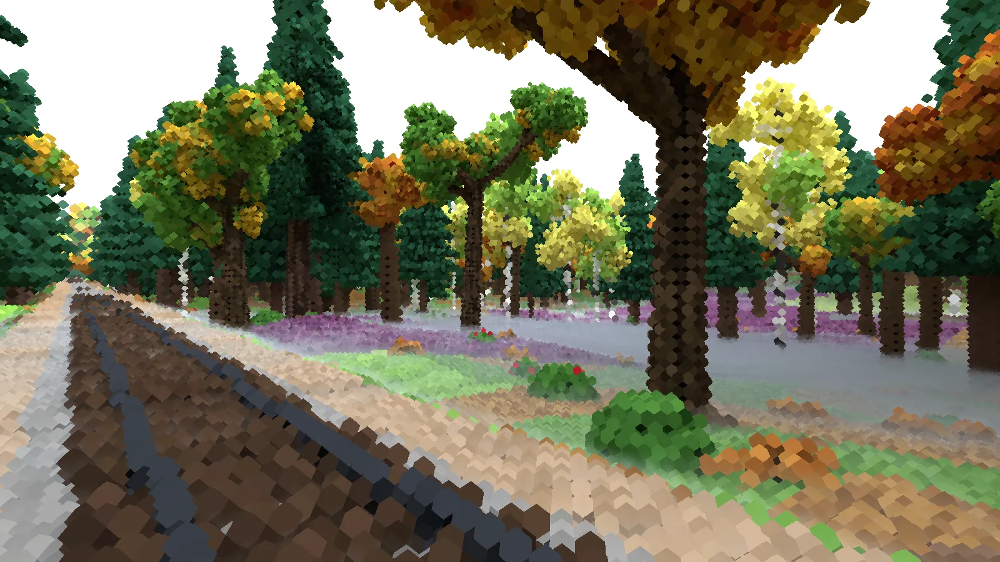
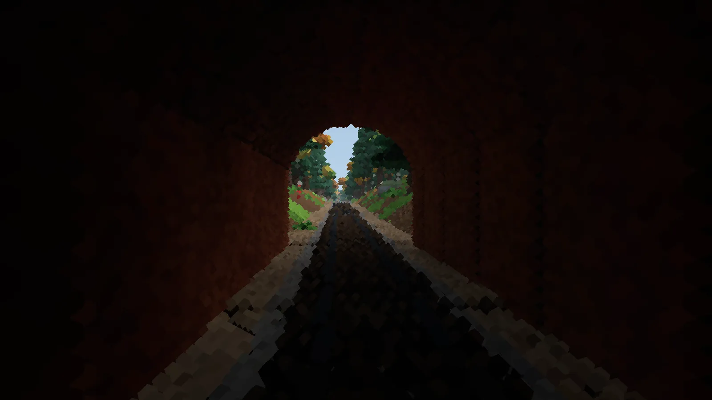
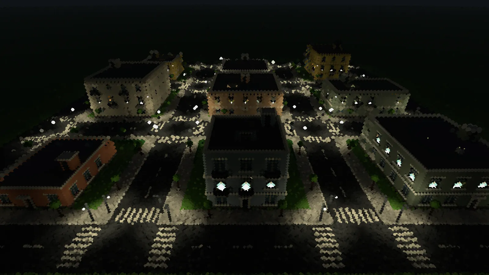
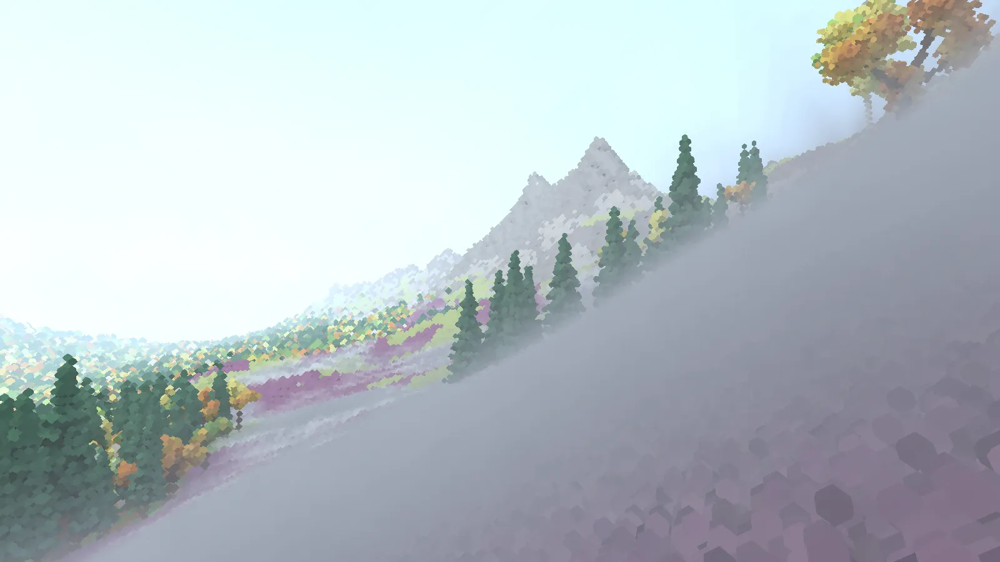
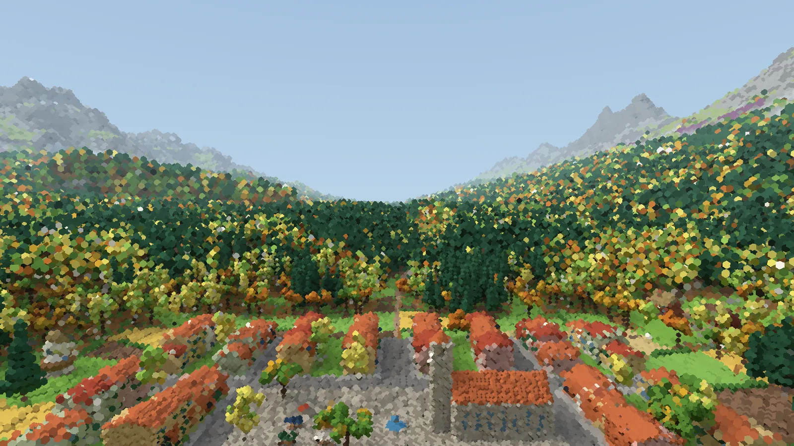

# Parallax Voxel Engine

Voxel worlds of rhombic dodecahedra on the face-centred cubic lattice,
generated in pieces at any level of detail,
and a frontend that draws them (`native/`, wgpu),
in a window or a browser:
by rays through the voxels,
or by cells of the lattice baked into chunks, drawn in relief.



<table>
<tr>
<td width="50%"><br><sub>The town's square by day</sub></td>
<td width="50%"><br><sub>And at night, by its lamps</sub></td>
</tr>
<tr>
<td><br><sub>Out of the railway's tunnel</sub></td>
<td><br><sub>The city at night</sub></td>
</tr>
<tr>
<td><br><sub>Mist under a peak</sub></td>
<td><br><sub>The valley, 5 km deep</sub></td>
</tr>
</table>

<sub>Lit by light worked out across the world:
`pnpm shot --size 1600x900 --shot out.png`
and the picture's title (hover over it).</sub>

## Design principles

> There are two ways of constructing a software design:
> one way is to make it so simple that there are obviously no deficiencies,
> and the other way is to make it so complicated
> that there are no obvious deficiencies.
> The first method is far more difficult.
>
> — C. A. R. Hoare, *The Emperor's Old Clothes* (1980)

We take the first way.
What the design is held to, beyond speed:

1. **Structure comes from the lattice, not the screen.**
   Chunks and every other partition follow the FCC lattice,
   and their boundaries run between voxels.
   A rectangle of pixels imposed from outside is a foreign element.
2. **Self-similarity.**
   Every coarser level is again an FCC lattice of rhombic dodecahedra:
   the same rule and the same geometry at every scale,
   with no special case for coarser levels.
3. **Isotropy over convenience.**
   No direction is preferred:
   the world must look the same along each of the 12 directions.
   This outranks nesting (a tree of cells) and ease of implementation.
4. **Elegance is a criterion in its own right.**
   Results should be visible, not only measured.
   A fix that needs more special cases is a sign to step back.

## Key ideas

Fidelity is perceptual, not geometric:
the engine simplifies what a viewer won't notice
and bounds, as an angle on screen, how far the rest can be off
(section 2 of [docs/architecture.md](docs/architecture.md),
where the sections below are too).
Moving makes only what comes into view,
and once a view is complete nothing is drawn till the camera moves.

1. **Rhombic dodecahedra on the FCC lattice.**
   A voxel meets its 12 nearest neighbours face to face, all equally far,
   and walls and floors along the axes stay flat (section 5).
   Each face may show a colour of its own,
   and the 12 faces are the 12 directions chunks are seen along.
2. **One hierarchy of cells for everything.**
   The cells of N·FCC, N = 1, 2, 4, …,
   shape chunks,
   levels of detail, and where generators place things (section 1).
3. **Rays across the lattice, or chunks named by it.**
   A ray goes from voxel to voxel across their faces,
   through each level of detail as far as it is held, then the next coarser.
   Or cells along 12 directions are baked as seen along their direction,
   each voxel at its depth, named by the lattice, not the camera,
   so a chunk, once baked, stays valid wherever the camera goes,
   and is drawn in relief (sections 3–4).
4. **Worlds generated in pieces, at any level of detail.**
   A world of `worlds/` on the generator framework of `worldgen/`
   (the forest, and the valley: the forest with a town and fields)
   gives the same voxels for any box generated alone, at any level.
   Levels agree on what a camera sees
   (how far rays get, what they stop on),
   not on exact geometry ([docs/generators.md](docs/generators.md)).
5. **Checked against rays.**
   Tests check levels of detail and what is drawn
   against rays cast through the world.

## Quick start

The frontend needs [Rust](https://rustup.rs/),
and a GPU (or Mesa's software Vulkan);
its options are in `native/src/main.rs`:

```bash
cargo run --release -p parallax-native
```

Controls: W/S forward/back, A/D left/right, Space/Shift up/down, arrow
keys or drag to look around.

In a browser with WebGPU it is the same code in WebAssembly,
by the voxels engine, its world made between frames, with no threads;
that takes Node, pnpm and Rust's WebAssembly target besides:

```bash
rustup target add wasm32-unknown-unknown
pnpm install
pnpm dev
```

The page takes the native frontend's options in its query,
each `--key value` as `key=value`
(`pnpm shot --help` lists them):
`?world=moor&camera=x,y,z&look=yaw,pitch&light=1,1,0`
(camera in lattice units, angles in degrees).

Other scripts (`check`, `test`, `lint`, `build`, `shot`)
are in `package.json`.

## Documentation

The documents are in `docs/`;
[AGENTS.md](AGENTS.md) lists them and when to read each.

## License

MIT, see [LICENSE](LICENSE).
