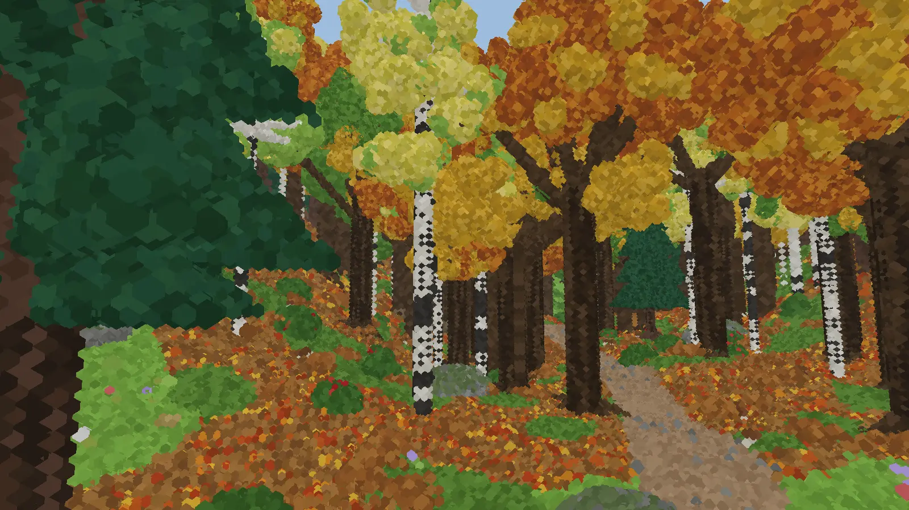
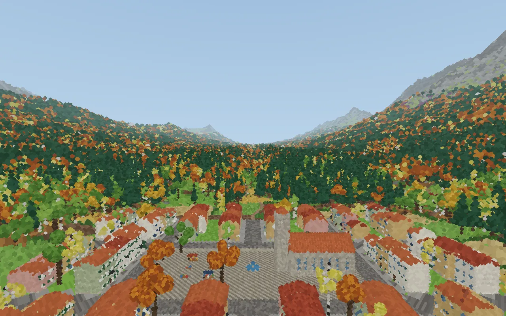
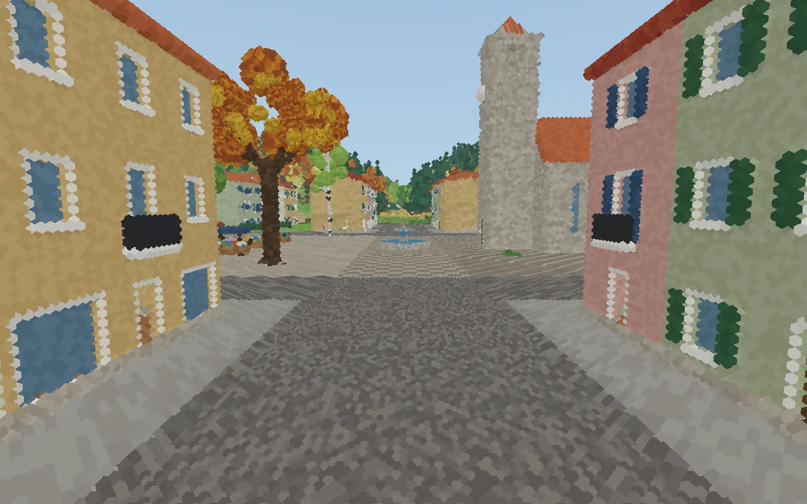
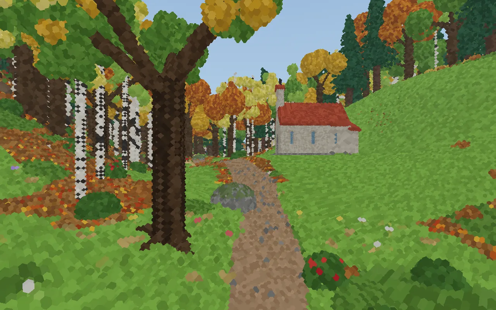
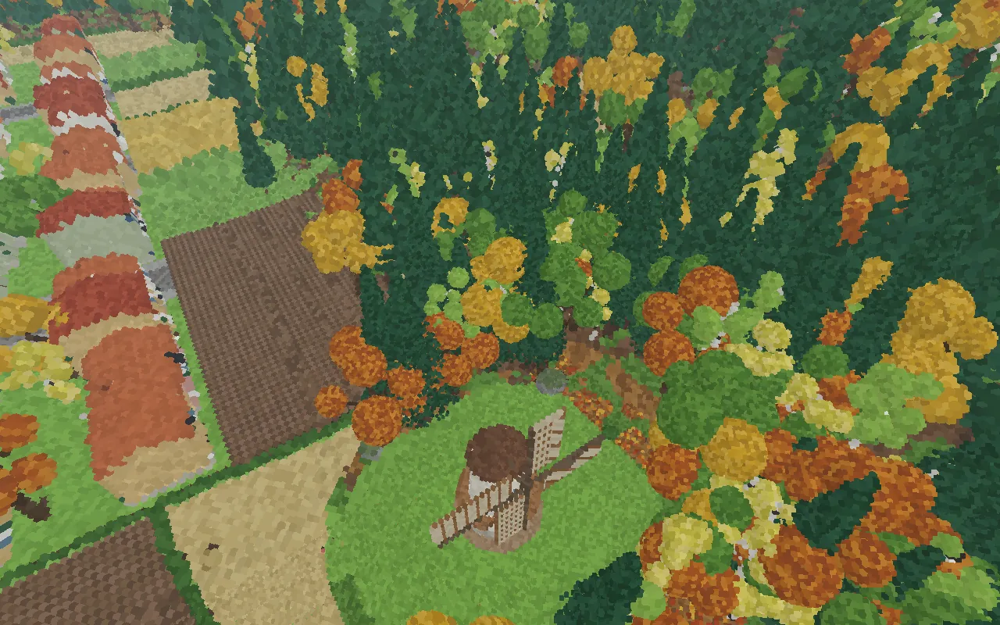
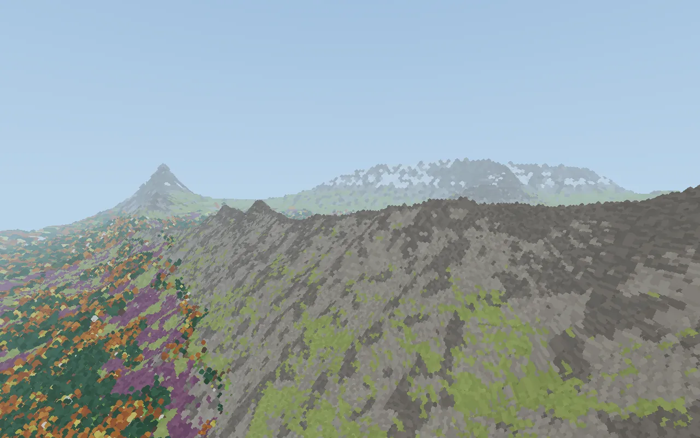
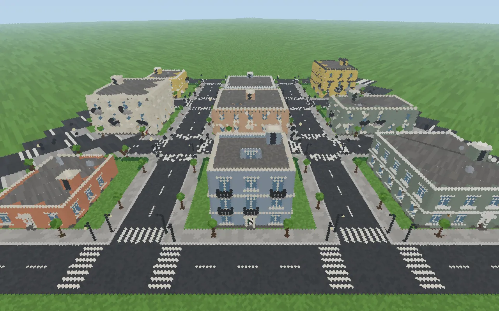
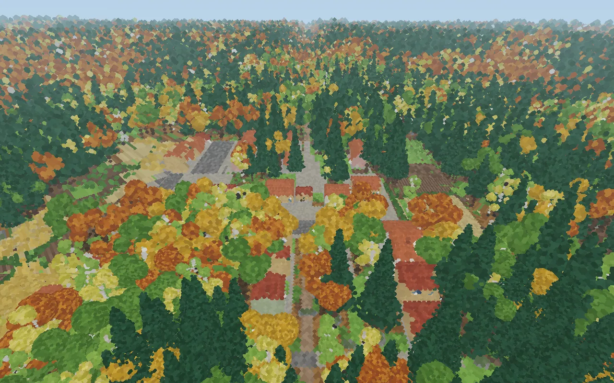
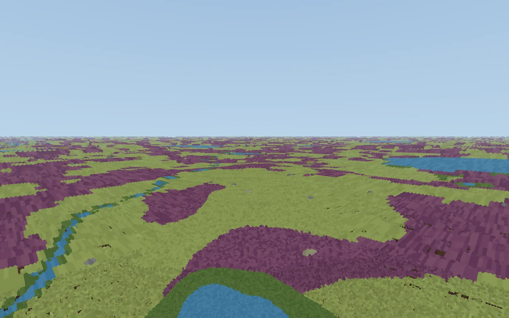

# Parallax Voxel Engine

Voxel worlds of rhombic dodecahedra on the face-centred cubic lattice,
generated in pieces at any level of detail,
and two frontends that draw them.
The web's (`web/`) renders a world as a stack of cached 2D
depth slices composited with WebGL. Slices get thicker with
distance, but never so thick that they show more than a small angle of what
true perspective would hide; camera movement mostly just moves cached
images.
The native one (`native/`, wgpu) draws it by rays through its voxels,
or by chunks as the web does, cells of the lattice instead of slices.



<table>
<tr>
<td width="50%"><br><sub>The valley, 5 km deep</sub></td>
<td width="50%"><br><sub>The town's square</sub></td>
</tr>
<tr>
<td><br><sub>A chapel by the path</sub></td>
<td><br><sub>A windmill among the fields</sub></td>
</tr>
<tr>
<td><br><sub>The ranges over the treeline</sub></td>
<td><br><sub>The city</sub></td>
</tr>
<tr>
<td><br><sub>The learned town</sub></td>
<td><br><sub>The moor, 5 km deep</sub></td>
</tr>
</table>

<sub>Seed 12345, drawn by `pnpm shot`;
each picture's view is its title (hover over it).</sub>

## Design principles

> There are two ways of constructing a software design:
> one way is to make it so simple that there are obviously no deficiencies,
> and the other way is to make it so complicated
> that there are no obvious deficiencies.
> The first method is far more difficult.
>
> — C. A. R. Hoare, *The Emperor's Old Clothes* (1980)

We take the first way.
What the design is held to, beyond speed:

1. **Structure comes from the lattice, not the screen.**
   Slices, chunks and every other partition follow the FCC lattice,
   and their boundaries run between voxels.
   A rectangle of pixels imposed from outside is a foreign element.
2. **Self-similarity.**
   Every coarser level is again an FCC lattice of rhombic dodecahedra:
   the same rule and the same geometry at every scale,
   with no special case for coarser levels.
3. **Isotropy over convenience.**
   No direction is preferred:
   the world must look the same along each of the 12 directions.
   This outranks nesting (a tree of cells) and ease of implementation.
4. **Elegance is a criterion in its own right.**
   Results should be visible, not only measured.
5. **Correct by construction, not by measurement.**
   A property should follow from how a thing is built,
   so that a whole class of mistakes can't be written.
   Checks and their lists of known exceptions are a safety net,
   not the design;
   when one catches something, ask what would make it impossible.
   A fix that needs more special cases is a sign to step back.

## Key ideas

Fidelity is perceptual, not geometric:
the engine simplifies what a viewer won't notice
and bounds, as an angle on screen, how far the rest can be off
(section 2 of [docs/architecture.md](docs/architecture.md),
where the sections below are too).

1. **Rhombic dodecahedra on the FCC lattice.**
   A voxel meets its 12 nearest neighbours face to face, all equally far,
   and walls and floors along the axes stay flat (section 6).
   Each face may show a material of its own,
   and the 12 faces are the 12 directions slices are seen along.
2. **One hierarchy of cells for everything.**
   The cells of N·FCC, N = 1, 2, 4, …,
   shape slices, chunks,
   levels of detail, and where generators place things (section 1).
3. **Slices named by the lattice, composited with parallax.**
   Slices along 12 directions are named by the lattice, not the camera,
   and baked as seen along their direction, each voxel at its depth,
   so a chunk, once baked, stays valid wherever the camera goes,
   and is drawn in relief (sections 3–5).
4. **Worlds generated in pieces, at any level of detail.**
   A world of `worlds/` on the generator framework of `worldgen/`
   (the forest, and the valley: the forest with a town and fields)
   gives the same voxels for any box generated alone, at any level.
   Levels agree on what a camera sees
   (how far rays get, what they stop on),
   not on exact geometry ([docs/generators.md](docs/generators.md)).
5. **Checked against rays.**
   Tests check leaks, painting order and levels of detail
   against rays cast through the world.

## Quick start

The web's chunks are baked and its worlds generated by Rust
compiled to WebAssembly (`web/wasm/`),
so besides Node and pnpm you need [Rust](https://rustup.rs/)
with its WebAssembly target:

```bash
rustup target add wasm32-unknown-unknown
pnpm install
pnpm dev
```

Controls: W/S forward/back, A/D left/right, Space/Shift up/down, arrow
keys or drag to look around.

The native frontend needs only Rust, and a GPU (or Mesa's software Vulkan);
its options are in `native/src/main.rs`:

```bash
cargo run --release -p parallax-native
```

The page takes a view in its query:
`?seed=&world=&camera=x,y,z&look=yaw,pitch&fov=&distance=&detail=`
(camera in lattice units, angles in degrees).

Other scripts (`test`, `lint`, `typecheck`, `knip`, `build`, `shot`,
`shot:native`) are in `package.json`.

## Documentation

The documents are in `docs/`;
[AGENTS.md](AGENTS.md) lists them and when to read each.

## License

MIT, see [LICENSE](LICENSE).
